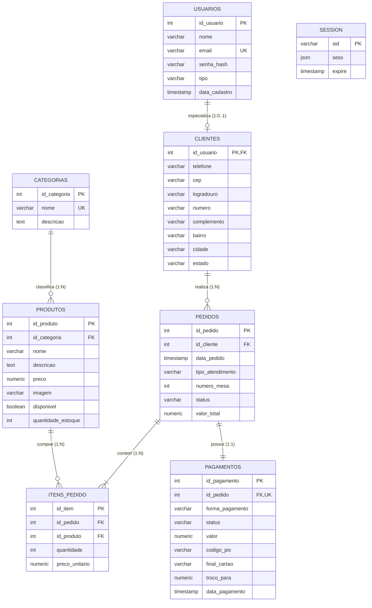

# ProjetoFinalDW1-Cafeteria
# ☕ Caffè D'Autore — Sistema Web de Cafeteria

Sistema web Full Stack desenvolvido para a gestão administrativa e operação de pedidos online da cafeteria **Caffè D'Autore**.

## 📑 Sumário
1. [Documentação do Sistema](#-1-documentação-do-sistema)
   - [Visão Geral e Arquitetura](#visão-geral-e-arquitetura)
   - [Perfis de Acesso e Funcionalidades](#perfis-de-acesso-e-funcionalidades)
   - [Regras de Negócio](#regras-de-negócio)
   - [Estrutura de Pastas](#estrutura-de-pastas)
   - [Documentação da API (Endpoints)](#documentação-da-api-endpoints)
2. [Diagrama e Dicionário do Banco de Dados](#-2-diagrama-e-dicionário-do-banco-de-dados)
   - [Modelo Entidade-Relacionamento (MER)](#modelo-entidade-relacionamento-mer)
   - [Descrição das Entidades e Cardinalidades](#descrição-das-entidades-e-cardinalidades)
3. [Guia de Execução](#-3-guia-de-execução)
   - [Pré-requisitos](#pré-requisitos)
   - [Passo 1: Clonar o Repositório](#passo-1-clonar-o-repositório)
   - [Passo 2: Configurar o Banco de Dados (PostgreSQL)](#passo-2-configurar-o-banco-de-dados-postgresql)
   - [Passo 3: Configurar Variáveis de Ambiente (.env)](#passo-3-configurar-variáveis-de-ambiente-env)
   - [Passo 4: Instalar Dependências e Iniciar o Servidor](#passo-4-instalar-dependências-e-iniciar-o-servidor)
   - [Passo 5: Acessar a Aplicação](#passo-5-acessar-a-aplicação)

---

## 📘 1. Documentação do Sistema

### Visão Geral e Arquitetura
A aplicação segue a arquitetura **Cliente-Servidor (REST API)**:
* **Frontend:** Desenvolvido em HTML5, CSS3 e JavaScript (ES6+), consumindo a API via `fetch` com envio de credenciais (`credentials: 'include'`).
* **Backend:** Servidor construído em **Node.js** com **Express**, gerenciamento de sessões persistentes no banco via `express-session` + `connect-pg-simple`, criptografia de senhas com `bcrypt` e disparo de e-mails transacionais com `nodemailer`.
* **Banco de Dados:** **PostgreSQL 18.3**, utilizando transações ACID (`BEGIN` / `COMMIT` / `ROLLBACK`), bloqueio de linha (`SELECT ... FOR UPDATE`) para controle de concorrência no estoque e restrições de integridade (`CHECK`, `UNIQUE`, `FOREIGN KEY`).

### Perfis de Acesso e Funcionalidades
* **Cliente (`tipo = 'cliente'`):**
  * Cadastro, login e edição de dados pessoais/endereço estruturado.
  * Recuperação de senha via código numérico de 6 dígitos enviado por e-mail.
  * Navegação no catálogo por categorias, montagem de carrinho e escolha entre **Consumo no Local** (informando o número da mesa) ou **Retirada**.
  * Pagamento via **PIX** (QR Code dinâmico na rede local com confirmação em tempo real), **Cartão de Crédito/Débito** ou **Dinheiro** (com cálculo de troco).
  * Consulta do histórico de pedidos e cancelamento de pedidos ainda pendentes.
* **Administrador / Gerente (`tipo = 'admin'`):**
  * Dashboard administrativo protegido por middleware de sessão e verificação de perfil.
  * Gerenciamento de **Pedidos** com filtro por status, coluna dedicada de detalhes de **Pagamento** (método, status `Pago`/`Pendente`/`Cancelado`, referência PIX, final do cartão e aviso de troco a devolver) e alteração da situação do pedido (`Pendente` → `Em Preparação` → `Pronto` → `Concluído` ou `Cancelado`).
  * Gerenciamento completo (CRUD) de **Produtos**, **Categorias** e controle de **Estoque**.

### Regras de Negócio
1. **Integridade de Atendimento:** Pedidos do tipo `local` exigem obrigatoriamente `numero_mesa > 0`; pedidos do tipo `retirada` exigem `numero_mesa IS NULL` (garantido pela constraint `ck_numero_mesa`).
2. **Controle Transacional de Estoque:** Ao finalizar um pedido, o sistema verifica e abate `quantidade_estoque` dentro de uma transação SQL. Caso o pedido seja cancelado (pelo cliente enquanto `pendente` ou pelo gerente), os itens são devolvidos automaticamente ao estoque.
3. **Imutabilidade de Pedidos Finalizados:** Pedidos marcados como `concluido` ou `cancelado` têm sua alteração de status bloqueada no painel administrativo.
4. **Relação 1:1 de Pagamento:** Todo pedido gera exatamente um registro correspondente na tabela `pagamentos` na mesma transação de criação.

### Estrutura de Pastas
```text
ProjetoCafeteria/
├── backend/
│   ├── config/
│   │   └── session.js          # Configuração de sessão persistente no PostgreSQL
│   ├── controllers/
│   │   └── pedidoController.js # Lógica transacional de pedidos, estoque e pagamentos
│   ├── routes/
│   │   ├── authRoutes.js       # Autenticação e controle de sessão
│   │   ├── categoriaRoutes.js  # Endpoints de categorias
│   │   ├── lojaRoutes.js       # Endpoints públicos da vitrine
│   │   ├── pedidoRoutes.js     # Endpoints de checkout e painel de pedidos
│   │   ├── perfilRoutes.js     # Endpoints de perfil e endereço do cliente
│   │   └── produtoRoutes.js    # Endpoints de produtos e estoque
│   ├── imagens/                # Imagens dos produtos
│   ├── database.js             # Conexão com o PostgreSQL (pg Pool)
│   ├── server.js               # Ponto de entrada do Express, rotas PIX e e-mail
│   └── package.json            # Dependências do projeto
├── frontend/
│   ├── esqueci-senha/          # Recuperação de senha com validação por código
│   ├── gerente/                # Painel administrativo (visão geral, produtos, categorias, pedidos)
│   ├── login/                  # Telas de login e cadastro
│   ├── loja/                   # Vitrine, carrinho e checkout de pagamento
│   └── perfil/                 # Área do cliente e acompanhamento de pedidos
└── documentacao/
    └── banco_completo.sql      # Script SQL completo (DDL + DML) do PostgreSQL
```

### Documentação da API (Endpoints)

| Método | Endpoint | Descrição | Permissão |
| :--- | :--- | :--- | :--- |
| `POST` | `/api/auth/cadastro` | Cadastra um novo cliente | Público |
| `POST` | `/api/auth/login` | Autentica usuário e inicia sessão | Público |
| `POST` | `/api/auth/logout` | Encerra a sessão ativa | Autenticado |
| `POST` | `/api/auth/solicitar-codigo` | Envia código de 6 dígitos para recuperação de senha | Público |
| `POST` | `/api/auth/redefinir-senha` | Valida o código e atualiza a senha no banco | Público |
| `GET` | `/api/produtos` | Lista produtos disponíveis na loja | Público |
| `POST` | `/api/produtos` | Cadastra novo produto | Admin |
| `PUT` | `/api/produtos/:id` | Atualiza produto e estoque | Admin |
| `GET` | `/api/categorias` | Lista categorias cadastradas | Público |
| `GET` | `/api/pix/info-rede` | Retorna o IP local da máquina para o QR Code PIX | Público |
| `GET` | `/api/pix/confirmar/:codigoPix` | Confirma o pagamento PIX após leitura no celular | Público |
| `GET` | `/api/pix/status/:codigoPix` | Verifica se o pagamento PIX já foi confirmado | Público |
| `POST` | `/api/pedidos` | Cria pedido, registra pagamento e abate estoque | Cliente |
| `GET` | `/api/pedidos/meus` | Retorna os pedidos do cliente logado | Cliente |
| `PATCH` | `/api/pedidos/:id/cancelar` | Cancela pedido pendente e estorna estoque | Cliente |
| `GET` | `/api/pedidos/admin/todos` | Lista todos os pedidos com itens e pagamento | Admin |
| `PATCH` | `/api/pedidos/admin/:id/status` | Altera o status do pedido | Admin |

---

## 🗄️ 2. Diagrama e Dicionário do Banco de Dados

### Modelo Entidade-Relacionamento (MER)



### Descrição das Entidades e Cardinalidades

| Tabela | Descrição | Relacionamentos / Cardinalidade |
| :--- | :--- | :--- |
| **`usuarios`** | Armazena credenciais de autenticação (`email`, `senha_hash`) e perfil (`cliente` ou `admin`). | **1 : 0..1** com `clientes`. |
| **`clientes`** | Especialização de `usuarios` contendo telefone e endereço estruturado (`cep`, `logradouro`, `numero`, `complemento`, `bairro`, `cidade`, `estado`). | **1 : N** com `pedidos`. |
| **`categorias`** | Agrupa os itens do cardápio por seção (`nome` único). | **1 : N** com `produtos`. |
| **`produtos`** | Catálogo de itens vendidos, preço unitário, imagem, flag `disponivel` e saldo em `quantidade_estoque`. | **N : 1** com `categorias`; **1 : N** com `itens_pedido`. |
| **`pedidos`** | Cabeçalho do pedido com data, atendimento (`local` ou `retirada`), `numero_mesa`, `status` e `valor_total`. | **N : 1** com `clientes`; **1 : N** com `itens_pedido`; **1 : 1** com `pagamentos`. |
| **`itens_pedido`** | Tabela associativa que resolve a relação N:M entre `pedidos` e `produtos`, registrando `quantidade` e `preco_unitario`. | **N : 1** com `pedidos` e `produtos`. |
| **`pagamentos`** | Registra a forma (`pix`, `credito`, `debito`, `dinheiro`), status (`pendente`, `aprovado`, `recusado`) e metadados (`codigo_pix`, `final_cartao`, `troco_para`). | **1 : 1** com `pedidos` (`id_pedido UNIQUE`). |
| **`session`** | Tabela auxiliar gerenciada pelo `connect-pg-simple` para persistência das sessões HTTP. | Independente. |

---

## 🚀 3. Guia de Execução

### Pré-requisitos
Certifique-se de ter instalado em sua máquina:
* **Node.js** (versão 18 ou superior) — [Download](https://nodejs.org/)
* **PostgreSQL** (versão 16 ou superior; projeto desenvolvido na v18.3) — [Download](https://www.postgresql.org/download/)
* **Git** — [Download](https://git-scm.com/)

### Passo 1: Clonar o Repositório
```bash
git clone [https://github.com/SEU-USUARIO/ProjetoCafeteria.git](https://github.com/SEU-USUARIO/ProjetoCafeteria.git)
cd ProjetoCafeteria
```

### Passo 2: Configurar o Banco de Dados (PostgreSQL)
1. Crie um banco de dados chamado `caffe_d_autore` no PostgreSQL (via pgAdmin ou terminal).
2. Importe o script completo localizado em `documentacao/banco_completo.sql` para criar todas as tabelas, constraints, índices e dados iniciais:

```bash
psql -U postgres -c "CREATE DATABASE caffe_d_autore;"
psql -U postgres -d caffe_d_autore -f documentacao/banco_completo.sql
```
*(No Windows, caso `psql` não esteja no PATH, execute pelo pgAdmin usando a opção **Query Tool** ou **Restore**).*

### Passo 3: Configurar Variáveis de Ambiente (`.env`)
Crie um arquivo chamado `.env` dentro da pasta `backend/` seguindo o modelo abaixo:

```env
PORT=3001

# Configurações do PostgreSQL
DB_HOST=localhost
DB_PORT=5432
DB_USER=postgres
DB_PASSWORD=sua_senha_do_postgres
DB_NAME=caffe_d_autore

# Segredo da sessão HTTP
SESSION_SECRET=chave_secreta_caffe_d_autore

# Credenciais SMTP para envio de código de recuperação de senha
EMAIL_USER=seu_email@gmail.com
EMAIL_PASS=sua_senha_de_app_google
```

### Passo 4: Instalar Dependências e Iniciar o Servidor
Acesse a pasta `backend/`, instale os pacotes do Node.js e inicie a aplicação:

```bash
cd backend
npm install
node server.js
```

Se tudo estiver correto, o terminal exibirá a mensagem indicando que o servidor está rodando na porta `3001` e conectado ao PostgreSQL.

### Passo 5: Acessar a Aplicação
Abra o navegador e acesse:
* **Tela de Login / Cadastro:** `http://localhost:3001/login/login.html`
* **Vitrine da Loja:** `http://localhost:3001/loja/loja.html`
* **Painel do Gerente (requer usuário `admin`):** `http://localhost:3001/gerente/gerente.html`

> **Nota sobre o pagamento PIX:** Para testar a leitura do QR Code com a câmera do celular, certifique-se de que o computador e o smartphone estejam conectados na **mesma rede Wi-Fi** e que a porta `3001` não esteja bloqueada pelo Firewall do Windows.

---

## 👩‍💻 Autoria

Desenvolvido por **Amanda Myskiw Pedroso** — Universidade Tecnológica Federal do Paraná (UTFPR - Campus Campo Mourão).
